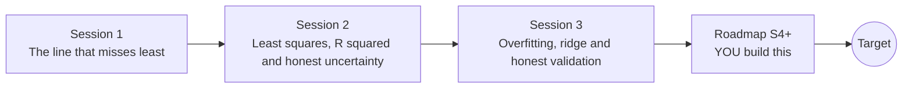

# openregression

[](https://github.com/KrunalPanchal1995/openregression/actions/workflows/ci.yml)   [](https://colab.research.google.com/github/KrunalPanchal1995/openregression/blob/main/sessions/session-01/lesson.ipynb) [](https://krunalpanchal1995.github.io/openregression/)

**Predict crop yield from rainfall, and learn to catch a model that only memorised the past.**

openregression teaches regression from the ground up with a farm example: least squares, residuals, prediction intervals, overfitting, ridge and cross-validation, using only Python and a browser.

- **Start from dots.** Session 1 needs only school algebra: a line, a miss and a total.
- **See it move.** Every session ships a slider app with labelled graphs that runs in the browser.
- **Trust, but verify.** Fits are checked against numpy.polyfit, against hand calculations and against the coefficients that generated the data.
- **Build the missing half.** The repo stops at Session 3 on purpose; the roadmap shows the path to the Target.

[Target](#the-target) · [Who is this for](#who-is-this-for) · [Quick start](#quick-start) · [Sessions](#sessions) · [Roadmap](#roadmap) · [Contribute](#contribute) · [Explainer PDF](docs/explainer.pdf)

> **This repo is incomplete on purpose.** Sessions 1 to 3 are here and fully working. The finished Target below is a preview of what the community can build next. We show you the path, not the code. Sessions 4 and up are yours.

## The Target

Four panels move together. A polynomial fit grows more and more flexible and starts to wiggle through the noise, while the test-error curve beside it draws the classic U shape (best degree 3 in the private run). Then a ridge penalty grows: the wiggles calm down and the coefficient paths shrink towards zero. Finally a prediction band around a straight line flares out where there are no data. Your goal over the coming sessions: build all four panels yourself.


*Target: growing degree and the test-error U curve, a ridge path, and a prediction band that flares*


*Target still: ridge fit, U curve, coefficient paths and prediction band*


*Training error keeps falling while test error turns back up*

Try it live:

- [Math Visual Studio: estimation, regression and the central limit theorem (Atlas S26)](https://krunalpanchal1995.github.io/studio/#atlas?ch=S26&ex=1)

How the Target was made is shown only as a path in [promo/roadmap.md](promo/roadmap.md).

## Who is this for
**higher secondary to advanced undergraduate (levels 4-6).** Topic area: Artificial Intelligence, Data Science and Robotics.

Prerequisites:

- School algebra: the equation of a straight line y = a + b x.
- Python 3.10 or newer; if `python --version` works, you are ready. PRIMER.md explains the rest.
- No prior statistics, GitHub or machine learning experience is needed.

New to Python? Read [PRIMER.md](PRIMER.md) first (10 minutes).

## Quick start

No installation knowledge needed. You need [Git](https://git-scm.com/downloads) and [Python 3.10+](https://www.python.org/downloads/) (Windows: tick "Add Python to PATH"). On Mac and Linux type `python3` wherever this page says `python`.

```bash
git clone https://github.com/KrunalPanchal1995/openregression.git
cd openregression
python start.py 1
```

`start.py` creates a private environment, installs what is needed and runs Session 1 with its checkpoint. Next: `python start.py 2`, `python start.py 3`, or `python start.py test` to check everything. Only a checkpoint: `python start.py check 1`.

Four lines turn the idea of Session 1 into a result (they work as they are): Save it as `try.py` and run it with `python start.py run try.py` (this uses the private environment, where NumPy is installed):

```python
import numpy as np
rain = np.array([3.0, 3.8, 4.5, 5.2, 5.8, 6.5, 7.2, 7.9, 8.6, 9.2])   # hundreds of mm
crop = np.array([2.0, 2.3, 2.4, 2.5, 2.8, 2.9, 3.4, 4.1, 3.8, 3.9])   # t/ha
b, a = np.polyfit(rain, crop, 1)
print(round(a, 3), round(b, 3))   # -> 0.887 0.344: yield = 0.887 + 0.344 * rain
```

Every session also opens in your browser with sliders (no install): [live apps](https://krunalpanchal1995.github.io/openregression/). Or use the Colab badge above for the notebook.

## Sessions

| # | Session | Model level | Time | Live app |
|---|---|---|---|---|
| 1 | [The line that misses least](sessions/session-01/README.md) | Level 1: conceptual interactive model | 60 min | [open](https://krunalpanchal1995.github.io/openregression/session-01/) |
| 2 | [Least squares, R squared and honest uncertainty](sessions/session-02/README.md) | Level 2: mathematical engineering model | 80 min | [open](https://krunalpanchal1995.github.io/openregression/session-02/) |
| 3 | [Overfitting, ridge and honest validation](sessions/session-03/README.md) | Level 3: simulation and validation | 90 min | [open](https://krunalpanchal1995.github.io/openregression/session-03/) |

Each session follows the same six steps: A real-world problem, B concept and theory, C visual explanation, D interactive simulation, E worked example and experiment, F assessment and design challenge. Each ends with `checkpoint.py`, which prints `PASS` or `FAIL` against reference numbers. Session 3 also contains the real-world mini-project: **Build and audit a yield model for next season**.

## Architecture



| Folder or file | What is inside |
|---|---|
| `sessions/` | three sessions: README (A-F), `lesson.py`, notebook, live app, exercises, activity sheet, checkpoint |
| `promo/` | the Target: media, live links, and the roadmap (path only) |
| `docs/` | `explainer.tex` and the built `explainer.pdf` |
| `tests/` | runs every lesson and checkpoint headless |
| `start.py` | one command to set up and run anything |
| `QUALITY.md`, `RUBRIC.md` | the quality checklist and the scoring rubric |
| `.github/` | CI, PDF build, Pages deploy, issue and PR templates |

## Roadmap

| Milestone | What you will build | Difficulty |
|---|---|---|
| Session 4: Intervals when the noise grows | A prediction interval that estimates the noise level as a function of rain. | intermediate |
| Session 5: A smooth model without choosing a degree | A smoother that replaces the polynomial in the degree-versus-error experiment. | intermediate |
| Session 6: Models that switch features off | A lasso solver by coordinate descent, written from the roadmap. | advanced |
| Session 7: Planning for a bad season | A line fitted by minimising the pinball loss. | advanced |

Full detail with a checkpoint per milestone: [promo/roadmap.md](promo/roadmap.md).

## Contribute
New to GitHub? Read [CONTRIBUTING.md](CONTRIBUTING.md); it starts from zero. Pick an issue labelled `good first issue`. Translations into Hindi, Telugu, Tamil and Malayalam are welcome.

<details>
<summary>Development</summary>

```bash
python start.py test        # runs every lesson and checkpoint
```
Lessons use `# %%` cell markers so they open as notebooks in VS Code. See [QUALITY.md](QUALITY.md) for the standard every session meets.
</details>

## License
MIT. See [LICENSE](LICENSE). Media in `promo/media` is (c) Krunal Panchal, CC BY 4.0.

## Acknowledgments
Part of the [PAN IIT OSS](https://hellofoss.tech-iitb.org/projects) open-source teaching collection, modelled on the structure of [openspline](https://github.com/openspline/openspline). Built on ideas from the Math Visual Studio at https://krunalpanchal1995.github.io/studio/.
