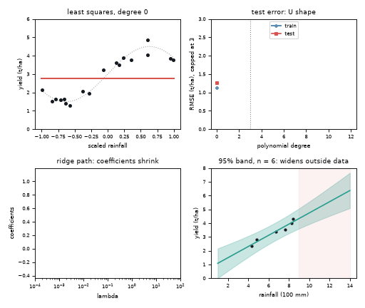
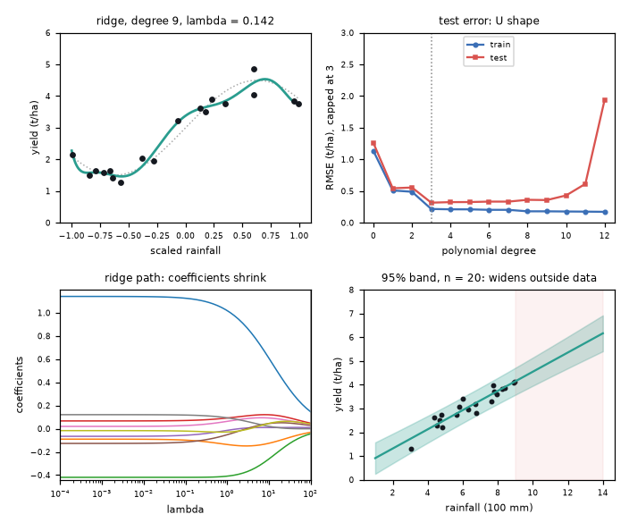
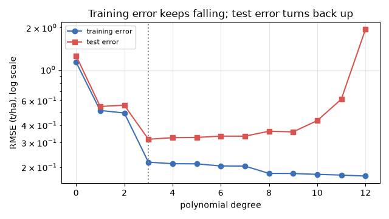

# What you are building toward

Four panels move together. A polynomial fit grows more and more flexible and starts to wiggle through the noise, while the test-error curve beside it draws the classic U shape (best degree 3 in the private run). Then a ridge penalty grows: the wiggles calm down and the coefficient paths shrink towards zero. Finally a prediction band around a straight line flares out where there are no data. Your goal over the coming sessions: build all four panels yourself.

*Target: growing degree and the test-error U curve, a ridge path, and a prediction band that flares*

*Target still: ridge fit, U curve, coefficient paths and prediction band*

*Training error keeps falling while test error turns back up*

These results come from a private reference build. The code is not published; the roadmap shows the path so you can build your own.

Live links:

- [Math Visual Studio: estimation, regression and the central limit theorem (Atlas S26)](https://krunalpanchal1995.github.io/studio/#atlas?ch=S26&ex=1)
