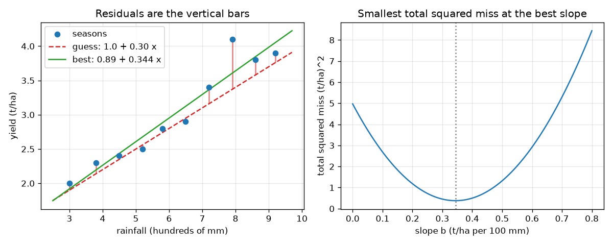

# Session 1: The line that misses least

*Level 1 (conceptual interactive model) · about 60 minutes · openregression*

> This is a simplified educational model. It is not a validated design tool and must not be used for real structures, electrical installations, vehicles, industrial processes or medical decisions.

**Prerequisites**

- School algebra: the equation of a straight line y = a + b x.
- You have read PRIMER.md and run `python start.py 1` once.

**Learning objectives.** After this session you can:

- Draw a line through rainfall and yield dots and read a forecast from it.
- Compute a residual (the vertical miss of one dot) and the total squared miss.
- Explain why the best line is the one with the smallest total squared miss.
- Find the best line by formula and check it by trying many other lines.

## A. Real-world problem
A farmer has ten seasons of records: how much rain fell and how much grain the field gave. Next season's rain forecast is known. What yield should the farmer expect? Drawing a line through the dots and reading off the answer is the idea of regression. But a hundred different lines can be drawn through the same dots. Which one is fair to call best? (All data here are made up for teaching; this is not advice about real farming.)

## B. Concept and theory
A straight line predicts yield from rain: prediction = a + b x. The intercept a is the yield predicted for zero rain; the slope b is the extra yield for each extra 100 mm. A residual is the observed yield minus the prediction, so it is the vertical distance from the dot to the line (positive if the dot is above). Adding the residuals would let misses above and below cancel, so we square them first. The total of the squares is the sum of squared residuals, SSE. The best line, called the least-squares line, has the smallest SSE. For ten farm seasons it is yield = 0.887 + 0.344 x, with SSE 0.378 (t/ha)^2.

| Symbol | Meaning | Unit |
|---|---|---|
| x | rainfall in a season (hundreds of mm, so 3.0 means 300 mm) | 100 mm |
| y | grain yield | t/ha |
| a | intercept of the line | t/ha |
| b | slope of the line | t/ha per 100 mm |
| e | residual = y - (a + b x) | t/ha |
| SSE | sum of squared residuals | (t/ha)^2 |

**Assumptions**

- A straight line is a reasonable description of the data.
- Only yield is predicted; rain is taken as given and measured exactly.
- The data are invented; the numbers teach the method, not farming.

$$ \hat y = a + b\,x,\qquad e_i = y_i-(a+b\,x_i) $$

$$ \mathrm{SSE}(a,b)=\sum_{i=1}^{n} e_i^{2} $$

$$ b=\frac{\sum (x_i-\bar x)(y_i-\bar y)}{\sum (x_i-\bar x)^2},\qquad a=\bar y-b\,\bar x $$

## C. Visual explanation
The left figure shows the ten dots, a guess line (yield = 1.0 + 0.30 x) and its residuals as red vertical bars, together with the best line in green. The best line leaves smaller bars: its total squared miss is 0.378 against 0.706 for the guess. The right figure plots SSE against the slope: a bowl with its lowest point at slope 0.344, the best slope.

*Ten seasons, a guess line with its residual bars, the best line, and the bowl of total squared miss against slope.*

## D. Interactive simulation
Run the lesson (`python start.py 1`), then open the live app: [Session 1: draw the line that misses least](https://krunalpanchal1995.github.io/openregression/session-01/) (or `app.html` in this folder). Move the intercept and slope sliders and watch the red bars and the total squared miss. Open the squares view to see each miss as a square, and the bowl view to see the total against the slope.

**Challenge.** Get the total squared miss below 0.45 (t/ha)^2 by hand-tuning the line.

## E. Worked example and experiment
**Problem.** Three dots (rain, yield) are (1, 2), (2, 2) and (3, 5). Find the least-squares line and its total squared miss by hand.

1. Means: x-bar = (1 + 2 + 3) / 3 = 2 and y-bar = (2 + 2 + 5) / 3 = 3.
2. Sum of (x - 2)(y - 3) = (-1)(-1) + (0)(-1) + (1)(2) = 1 + 0 + 2 = 3. Sum of (x - 2)^2 = 1 + 0 + 1 = 2.
3. Slope b = 3 / 2 = 1.5. Intercept a = 3 - 1.5 * 2 = 0.
4. Predictions: 1.5, 3.0, 4.5. Residuals: 2 - 1.5 = 0.5, 2 - 3 = -1, 5 - 4.5 = 0.5.
5. SSE = 0.25 + 1 + 0.25 = 1.5. Check: the residuals add up to 0.5 - 1 + 0.5 = 0.

**Answer.** The line is y = 0 + 1.5 x with residuals 0.5, -1 and 0.5 and total squared miss 1.5.

**Experiment.** Plot ten real (or classmates') pairs such as hand span against height on squared paper, draw the line you think is best with a ruler, then compute its SSE and compare with the formula's line. Your eye usually lands within a few percent of the minimum, but not on it. The model (a straight line) is simpler than reality: real points scatter for reasons the line does not know, and that scatter is what the residuals measure.

## F. Assessment and design challenge
**Question type A: Conceptual.** Why do we square the residuals instead of just adding them up? What would happen to the line 'sum of residuals = 0' test?

Hint

Think of one dot far above the line and one far below.

Step-by-step solution

Residuals above and below the line have opposite signs and cancel, so the plain sum can be zero for a terrible line: any line through the point (x-bar, y-bar) has residuals that add to zero, whatever its slope. Squaring makes every miss positive and makes a large miss count more than several small ones, so only a line that is close to all the dots gets a small total.

**Question type B: Numerical.** Find the least-squares line for the dots (0, 2), (1, 1) and (2, 6), and its total squared miss.

Hint

x-bar = 1, y-bar = 3. Use b = sum((x - x-bar)(y - y-bar)) / sum((x - x-bar)^2).

Step-by-step solution

Sum of (x - 1)(y - 3) = (-1)(-1) + 0 + (1)(3) = 4 and sum of (x - 1)^2 = 2, so b = 2 and a = 3 - 2 = 1. Predictions 1, 3, 5 give residuals 1, -2, 1 and SSE = 1 + 4 + 1 = 6 (units t/ha squared if the numbers are yields).

**Question type C: Graph and simulation interpretation.** In the bowl view, at which slope is the green curve lowest, and what is its value there? Why is the blue curve never below the green one?

Hint

The green curve uses the best intercept for every slope.

Step-by-step solution

The green curve is lowest at slope 0.344 t/ha per 100 mm, where it equals 0.378 (t/ha)^2, the best possible total. The blue curve uses your own intercept, which is not the best for most slopes, so it can touch the green curve but never go below it.

**Question type D: Design and optimisation challenge.** Design: using the best line of the farm data, how much rain gives an expected yield of 3.5 t/ha? Is the answer inside the range of the data? What should you worry about?

Hint

Solve 3.5 = 0.887 + 0.344 x for x.

Step-by-step solution

x = (3.5 - 0.887) / 0.344 = 7.59 hundreds of mm, that is about 759 mm. The data cover 300 to 920 mm, so this is interpolation, which is safer than extrapolation. But it is only the expected yield: single seasons scatter around the line (Session 2 puts a number on that), so a season with that rain can easily give less than 3.5 t/ha.

Score yourself with [RUBRIC.md](../../RUBRIC.md). Print the [activity sheet](activity_sheet.md) to work on paper.

## Common misconceptions
| Common misconception | What is actually true |
|---|---|
| The best line passes through as many dots as possible. | The best line minimises the total squared miss; it may pass through no dot at all. |
| Residuals above and below the line cancel, so the sum of residuals shows the fit is good. | For the least-squares line the residuals always add to zero, but so they do for many bad lines; only the sum of squares measures quality. |
| A line that fits the dots shows that rain causes the yield. | The line describes how the two move together. Causation needs more (Session 3 shows a trap). |
| The intercept is always a meaningful prediction. | The intercept is the prediction at zero rain, which is far outside the data; treat it as a fitting constant. |

## Glossary
- **regression**: predicting a number from other numbers by fitting a curve to data
- **residual**: observed value minus predicted value; the vertical miss of a dot
- **least squares**: choosing the line with the smallest sum of squared residuals
- **intercept**: the value of the line at x = 0
- **slope**: the change in the prediction when x grows by one unit

## Finish
1. Do the three coding tasks in [exercises.md](exercises.md).
2. Run `python start.py 1` again after your changes. It ends with the checkpoint; when it prints `PASS`, you are done. (Checkpoint only: `python start.py check 1`.)

Next: [Session 2](../session-02/README.md)
