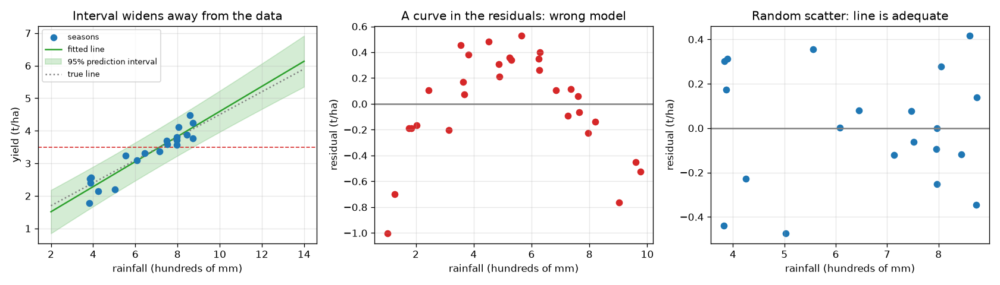

# Session 2: Least squares, R squared and honest uncertainty

*Level 2 (mathematical engineering model) · about 80 minutes · openregression*

> This is a simplified educational model. It is not a validated design tool and must not be used for real structures, electrical installations, vehicles, industrial processes or medical decisions.

**Prerequisites**

- Session 1: residuals and the least-squares line.
- Basic matrix multiplication (explained in Section B).

**Learning objectives.** After this session you can:

- Derive the normal equations and solve them to get the best line and check it against numpy.polyfit.
- Compute and interpret R squared, and read a residual plot for warning signs.
- Fit two inputs with numpy.linalg.lstsq and verify that the normal equations hold.
- Build a 95 percent prediction interval, test its coverage by simulation, and use it to answer a design question.

## A. Real-world problem
A farm adviser says: 'to reach 3.5 tonnes per hectare you need about 716 mm of rain'. A good adviser adds how sure she is. How much rain makes the target likely rather than just average? And can she trust the line when the forecast is 1000 mm, wetter than any season on record? This session turns the best line into a calculation with an honest margin of error. All data are synthetic, generated with known coefficients so that we can check our answers.

## B. Concept and theory
Stack the data as y = X beta: each row of X is (1, x) and beta = (a, b). The total squared miss is S(beta) = (y - X beta)^T (y - X beta). Setting its derivative to zero gives -2 X^T (y - X beta) = 0, the normal equations (X^T X) beta = X^T y. They say the residual vector is perpendicular to every column of X. R squared = 1 - SS_res / SS_tot is the fraction of the variation of y about its mean that the line explains; for one input it equals the square of the correlation. It does not prove the model is right: if the residuals show a pattern (a curve, a funnel), the model is wrong however large R squared is. With two inputs (rain r and fertiliser f) X has three columns and the same equations hold. A prediction interval for one new season at x0 is yhat0 +- t s sqrt(1 + 1/n + (x0 - x-bar)^2 / Sxx), where s^2 = SS_res / (n - 2) and t is the Student t quantile with n - 2 degrees of freedom. The '1' inside the root is the season's own noise; the other terms are uncertainty in the line, which grows with the distance from x-bar. Extrapolating beyond the data is dangerous because the formula assumes the line still holds.

| Symbol | Meaning | Unit |
|---|---|---|
| X | design matrix: a column of ones, then the inputs | no unit |
| beta | vector of coefficients (a, b, ...) | t/ha and t/ha per input unit |
| SS_res | sum of squared residuals | (t/ha)^2 |
| SS_tot | sum of (y - y-bar)^2 | (t/ha)^2 |
| R^2 | fraction of variation explained | no unit |
| s | residual standard deviation, sqrt(SS_res / (n - p)) | t/ha |
| t | Student t quantile (0.975, n - 2 degrees of freedom) | no unit |
| Sxx | sum of (x - x-bar)^2 | (100 mm)^2 |

**Assumptions**

- Noise is independent, has the same spread everywhere and is roughly normal.
- The straight-line (or linear-in-inputs) model is right inside the data range.
- New seasons come from the same farm and climate as the data.

$$ (X^{\mathsf T}X)\,\beta = X^{\mathsf T}y\quad\Longleftrightarrow\quad X^{\mathsf T}(y-X\beta)=0 $$

$$ R^2 = 1-\frac{\mathrm{SS}_{\mathrm{res}}}{\mathrm{SS}_{\mathrm{tot}}},\qquad \mathrm{SS}_{\mathrm{tot}}=\sum (y_i-\bar y)^2 $$

$$ \hat y_0 \pm t_{0.975,\,n-2}\; s\,\sqrt{1+\frac{1}{n}+\frac{(x_0-\bar x)^2}{S_{xx}}} $$

$$ \widehat{\mathrm{SE}}(\hat\beta_j)=\sqrt{s^2\,[(X^{\mathsf T}X)^{-1}]_{jj}} $$

## C. Visual explanation
The left figure shows 20 synthetic seasons with the fitted line, its 95 percent prediction band and the true line (dotted); the band is narrowest at the mean rain and flares outside the data, and the dashed red line is the 3.5 t/ha target. The middle figure shows residuals of a straight line fitted to curved (saturating) data: they bend into an arch pattern, so the line is wrong although R squared is 0.837. The right figure shows the residuals of a line fitted to genuinely straight data: shapeless scatter.

*Left: fitted line with a 95 percent prediction band and the 3.5 t/ha target. Middle: arch-shaped residuals of a line through curved data. Right: shapeless residuals of a line through straight data.*

## D. Interactive simulation
Run the lesson (`python start.py 2`), then open the live app: [Session 2: how wide is the prediction band?](https://krunalpanchal1995.github.io/openregression/session-02/) (or `app.html` in this folder). Change the noise, the number of seasons and the rain value. Watch the band and the half-width: it shrinks with more seasons, grows with noise, and grows fast outside the shaded data region.

**Challenge.** At 1100 mm of rain (x0 = 11), make the 95 percent half-width at most 0.5 t/ha, using noise of 0.2 t/ha or less.

## E. Worked example and experiment
**Problem.** For the dots (1, 2), (2, 2), (3, 5) compute R squared by hand, then predict the yield at x = 4.

1. From Session 1 the line is y = 0 + 1.5 x with residuals 0.5, -1, 0.5, so SS_res = 1.5.
2. The mean of y is 3, so SS_tot = (2 - 3)^2 + (2 - 3)^2 + (5 - 3)^2 = 1 + 1 + 4 = 6.
3. R squared = 1 - 1.5 / 6 = 0.75.
4. Check with the correlation: r = Sxy / sqrt(Sxx Syy) = 3 / sqrt(2 * 6) = 0.866, and r^2 = 0.75.
5. Prediction at x = 4: 0 + 1.5 * 4 = 6.0. This is extrapolation (the data stop at 3), so it deserves little trust.

**Answer.** R squared = 0.75 (75 percent of the variation explained) and the prediction at x = 4 is 6.0, an extrapolation.

**Experiment.** Simulate the experiment yourself: generate 20 seasons from y = 1.0 + 0.35 x + noise (sd 0.3), build the interval for a new season at 600 mm and check whether a new random season falls inside; repeat 2000 times. About 95 percent of the intervals catch the new season (the lesson measures 0.96). Real farms differ from the simulation: weather, pests and soil add structure the straight line and normal noise do not contain, so real coverage is usually lower than the nominal 95 percent.

## F. Assessment and design challenge
**Question type A: Conceptual.** A line fitted to curved data has R squared 0.837. Is it a good model? What does the residual plot show, and what would you do?

Hint

R squared measures how much variation is explained, not whether the shape is right.

Step-by-step solution

R squared of 0.837 is high, but the residuals form an arch (the correlation of the residuals with (x - x-bar)^2 is -0.90): negative at both ends and positive in the middle. A pattern in the residuals means the straight line is the wrong shape. We should add a curved term or use a saturating model, not trust the line for forecasts.

**Question type B: Numerical.** For the dots (1, 2), (2, 2), (3, 5) the best line is y = 1.5 x. Show that the normal equations hold, i.e. that X^T e = 0 for the residuals e = (0.5, -1, 0.5).

Hint

The columns of X are (1, 1, 1) and (1, 2, 3).

Step-by-step solution

Column of ones: 0.5 - 1 + 0.5 = 0. Column of x: 1 * 0.5 + 2 * (-1) + 3 * 0.5 = 0.5 - 2 + 1.5 = 0. Both products vanish, so the residuals are perpendicular to both columns, which is exactly the normal equations.

**Question type C: Graph and simulation interpretation.** In the app (noise 0.30 t/ha, 20 seasons) the band is narrowest at 600 mm. What is the half-width there, and what is it at 1100 mm? Why is it larger?

Hint

Read the readout at x0 = 6 and at x0 = 11.

Step-by-step solution

At 600 mm the half-width is 0.65 t/ha (mostly the season's own noise) and at 1100 mm it is 0.76 t/ha, because the term (x0 - x-bar)^2 / Sxx grows with the distance from the mean rain: the slope's uncertainty is multiplied by a longer lever arm. The band flares like a bow tie around the centre of the data.

**Question type D: Design and optimisation challenge.** Design: with 20 farm seasons, how much rain is needed for a 3.5 t/ha yield on average, and how much so that the lower end of the 95 percent prediction interval reaches 3.5 t/ha? Comment on the trade-off.

Hint

Invert the line for the first part; for the second, find the smallest rain whose lower bound is at least 3.5.

Step-by-step solution

The line gives 716 mm (x = 7.16 in 100 mm) for the average. For the lower bound of the 95 percent interval to reach 3.5 t/ha we need 872 mm, an extra 156 mm, because we are asking not for the average season but for nearly every season. Both values lie inside the data range (up to 900 mm), so no extrapolation is needed. The trade-off: certainty costs rain (or irrigation); a farmer who accepts a 1-in-20 miss on the lower side pays less.

Score yourself with [RUBRIC.md](../../RUBRIC.md). Print the [activity sheet](activity_sheet.md) to work on paper.

## Common misconceptions
| Common misconception | What is actually true |
|---|---|
| A high R squared means the model is correct. | R squared can be high for a model of the wrong shape (0.837 for a line through curved data). Always look at the residuals. |
| The 95 percent interval says 95 percent of seasons fall in it. | It says that a new season falls inside with probability 95 percent, taking into account the uncertainty of the fitted line, if the assumptions hold. |
| A confidence interval for the line and a prediction interval are the same. | The prediction interval adds the noise of a single new season (the 1 under the root) and is always wider. |
| The line can be trusted beyond the data because it is a formula. | A line fitted on 100 to 500 mm of a saturating response predicts 8.08 t/ha at 1000 mm where the truth is 5.05 t/ha. |

## Glossary
- **normal equations**: (X^T X) beta = X^T y: the conditions for the least-squares solution
- **R squared**: fraction of the variation of y explained by the model
- **standard error**: typical size of the error in an estimated coefficient
- **prediction interval**: range expected to contain one new observation with a stated probability
- **extrapolation**: predicting outside the range of the data used to fit the model
- **lstsq**: numpy function that solves least-squares problems

## Finish
1. Do the three coding tasks in [exercises.md](exercises.md).
2. Run `python start.py 2` again after your changes. It ends with the checkpoint; when it prints `PASS`, you are done. (Checkpoint only: `python start.py check 2`.)

Next: [Session 3](../session-03/README.md)
