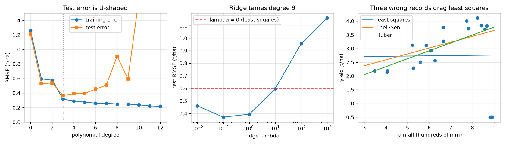

# Session 3: Overfitting, ridge and honest validation

*Level 3 (simulation and validation) · about 90 minutes · openregression*

> This is a simplified educational model. It is not a validated design tool and must not be used for real structures, electrical installations, vehicles, industrial processes or medical decisions.

**Prerequisites**

- Session 2: normal equations, residuals, prediction intervals.
- Matrix inverse and the idea of a standard deviation.

**Learning objectives.** After this session you can:

- Measure training and test error against polynomial degree and find the best degree.
- Use ridge regression (closed form) and k-fold cross-validation, written by you, to choose a setting honestly.
- Measure bias and variance by refitting on many resampled data sets.
- Recognise and handle outliers, confounders and collinear inputs, and audit a model with a prediction interval.

## A. Real-world problem
A model with enough knobs can pass through every training point and still predict next season badly. Nothing looks wrong on the data it was built from, which is exactly why overfitting is dangerous. This session measures the effect, tames it with ridge regression, chooses settings with cross-validation instead of wishful thinking, and then meets three traps: wrong data points, a hidden variable that makes two things look connected (ice-cream sales and drownings), and two inputs that are almost copies of each other. It ends with a complete audit of a yield model. This is general education about modelling on synthetic data, not agronomic advice.

## B. Concept and theory
A degree-d polynomial has d + 1 coefficients. Training error (RMSE, in t/ha) can only fall as d grows. Test error, measured on fresh data, falls and then rises: a U shape. The total expected error splits into noise (which nobody can remove), squared bias (the model cannot bend enough) and variance (the fit changes a lot from one data set to another). Flexible models have low bias and high variance. Ridge regression shrinks the coefficients by adding lambda times their squared size to the loss; on standardised features (subtract the mean, divide by the standard deviation) the solution is beta = (X^T X + lambda I)^-1 X^T y, and lambda = 0 gives ordinary least squares. We choose lambda or the degree by k-fold cross-validation: split the training seasons into k parts, train on k - 1, score on the rest, rotate and average. Least squares is damaged by outliers; the Theil-Sen line (median of pairwise slopes) and the Huber line (iteratively reweighted least squares) resist them. A confounder (temperature) can create a correlation between two quantities that do not influence each other; the partial correlation, after removing the confounder's linear effect from both, shows it. If two inputs are nearly identical the condition number of X^T X explodes: the coefficients become wild (huge variance) while predictions that use them together stay fine. Because the data are synthetic we can check the fits against the truth: slope +- 1.96 standard errors should hold the true slope in about 95 percent of repeats, and the standard error falls like 1 / sqrt(n).

| Symbol | Meaning | Unit |
|---|---|---|
| d | polynomial degree | no unit |
| lambda | ridge penalty strength | no unit (features standardised) |
| RMSE | root mean squared error = sqrt(mean of squared misses) | t/ha |
| k | number of cross-validation folds | no unit |
| z | scaled rainfall in [-1, 1] | no unit |
| cond | condition number of X^T X (largest / smallest eigenvalue) | no unit |
| rho(A,B \| T) | partial correlation of A and B given T | no unit |

**Assumptions**

- The true response is smooth: yield = 3 + 1.5 sin(2.5 z) plus normal noise of sd 0.30 t/ha (known only because the data are synthetic).
- Training seasons and test seasons come from the same process.
- Features are standardised before ridge, and the intercept is not penalised.
- Cross-validation folds are chosen at random with a fixed seed.

$$ \hat\beta_{\mathrm{ridge}}=(X^{\mathsf T}X+\lambda I)^{-1}X^{\mathsf T}y $$

$$ \mathbb E\big[(\hat f(z_0)-y_0)^2\big]=\sigma^2+\mathrm{bias}^2+\mathrm{variance} $$

$$ \mathrm{CV}_k=\frac1k\sum_{j=1}^{k}\mathrm{RMSE}_j\ \text{ (RMSE on fold } j \text{ after training on the others)} $$

$$ \rho_{AB\cdot T}=\mathrm{corr}\big(A-\hat A(T),\ B-\hat B(T)\big) $$

$$ \mathrm{SE}(\hat b)=\frac{\sigma}{\sqrt{S_{xx}}} $$

## C. Visual explanation
The left figure plots training and test RMSE against polynomial degree: training error keeps falling to 0.22 t/ha at degree 12, but test error is smallest (0.365 t/ha) at degree 3 and explodes to 5.1 t/ha at degree 12. The middle figure shows how ridge lowers the test error of a degree-9 fit as lambda grows from 0 (0.596) to 0.1 (0.371), and how too much ridge (lambda 1000) damages it (1.16). The right figure shows a least-squares line dragged flat (slope 0.009) by three wrongly recorded high-rain seasons, while the Theil-Sen (0.215) and Huber (0.290) lines stay closer to the true slope 0.35.

*Left: training and test error against degree. Middle: ridge test error against lambda. Right: robust lines against least squares when three records are wrong.*

## D. Interactive simulation
Run the lesson (`python start.py 3`), then open the live app: [Session 3: overfitting and ridge](https://krunalpanchal1995.github.io/openregression/session-03/) (or `app.html` in this folder). Raise the polynomial degree and watch the training error fall while the expected test error turns up. Then raise log10(lambda) and watch ridge pull the wiggles flat.

**Challenge.** Keep the degree at 9 but choose lambda (log10 lambda between -1 and -0.5) so that the expected test error is below 0.4 t/ha.

## E. Worked example and experiment
**Problem.** Three points x = -1, 0, 1 with y = 0, 1, 5. Compute the ridge slope by hand for lambda = 0 and lambda = 3 (standardise x first), and convert back to the original units.

1. x-bar = 0 and the standard deviation (dividing by n) is sqrt(2/3) = 0.8165, so the standardised values are about -1.2247, 0, 1.2247.
2. y-bar = 2, so the centred y are -2, -1, 3. X^T X = 3 (sum of squares of standardised x) and X^T y = (-1.2247)(-2) + (1.2247)(3) = 6.1237.
3. Ridge slope = 6.1237 / (3 + lambda). For lambda = 0 this is 2.0412; for lambda = 3 it is 1.0206, exactly half.
4. Back to original units divide by 0.8165: 2.5 for lambda = 0 (the ordinary slope Sxy / Sxx = 5 / 2) and 1.25 for lambda = 3.

**Answer.** Ridge slope 2.5 at lambda = 0 (least squares) and 1.25 at lambda = 3: the penalty multiplies the slope by 3 / (3 + lambda).

**Experiment.** Hands-on comparison: draw 20 points from any smooth curve plus noise on paper (or with the lesson's `make_response`), then fit a line, a cubic and a degree 9 polynomial. Hold out five points before fitting and score on them: the wiggly curve looks best on the points it saw and worst on the held-out ones. Reality differs from the model because real noise is not normal, features are not clean powers of rain, and the hold-out set is small, so any measured error has its own uncertainty (cross-validation picked degree 6 on these 20 seasons while the best test degree was 3).

## Real-world application and mini-project: Build and audit a yield model for next season
A synthetic farm has 60 seasons of data: rain (hundreds of mm), fertiliser (10 kg/ha units) and mean temperature (degrees C). Use `farm_dataset`, fit yield on the three inputs by least squares, audit it, and forecast next season (550 mm of rain, 60 kg/ha, 25 degrees C). The audit must compare four models by 6-fold cross-validation: the mean only, rain only, the three inputs, and a too-flexible model with all squares and products. This is a teaching exercise on invented data, not agronomic advice.

**Deliverable:** A script that prints the fitted coefficients, R squared, the four cross-validated RMSE values, a residual plot saved as a picture, and next season's yield with its 95 percent prediction interval, followed by two sentences on what the interval means and what it does not cover.

**Success looks like:** The three-input model has the smallest cross-validated RMSE (0.343 t/ha, against 0.724 for the mean only, 0.440 for rain only and 0.381 for the too-flexible model), R squared is 0.797 and next season's forecast is 1.64 t/ha with a 95 percent interval of 0.95 to 2.32 t/ha.

## F. Assessment and design challenge
**Question type A: Conceptual.** A colleague picks the polynomial degree with the smallest training error and reports it. Why is that wrong, and what should be done instead?

Hint

Compare the training error at degree 3 and degree 12.

Step-by-step solution

Training error can only go down as degree increases (0.22 t/ha at degree 12 against about 0.32 at degree 3), so choosing by training error always picks the most flexible model, which here has a test error of 5.1 t/ha. Choose by error on data the model has not seen: a separate test set or k-fold cross-validation.

**Question type B: Numerical.** For the three points x = -1, 0, 1 with y = 0, 1, 5, find the ridge slope in original units for lambda = 6.

Hint

The slope is multiplied by 3 / (3 + lambda) compared with least squares (2.5).

Step-by-step solution

Factor = 3 / (3 + 6) = 1/3, so the slope is 2.5 / 3 = 0.833. The larger the penalty, the closer the slope gets to zero (and the prediction to the mean of y).

**Question type C: Graph and simulation interpretation.** In the app, at degree 9, compare the expected test error at log10 lambda = -4 and at -1. What does each tell you about the fit?

Hint

Read the readout and the fit view for both settings.

Step-by-step solution

At log10 lambda = -4 (practically least squares) the training error is 0.250 but the expected test error is 0.832 t/ha: the curve wiggles through the noise. At log10 lambda = -1 the training error rises to 0.291 but the expected test error falls to 0.357 t/ha, close to the noise floor of 0.30: ridge trades a little bias for much less variance.

**Question type D: Design and optimisation challenge.** Design: for the farm data set of the mini-project, you can deploy the mean only, rain only, the three inputs, or the too-flexible model. Choose by cross-validation and give the forecast for 550 mm, 60 kg/ha, 25 degrees C with its interval. What do you tell the farmer about it?

Hint

Use `farm_audit` and `prediction_interval_multi`.

Step-by-step solution

6-fold RMSE (t/ha): mean only 0.724, rain only 0.440, three inputs 0.343, too flexible 0.381. The three-input model wins and the flexible one is worse, a mild overfit. The forecast is 1.64 t/ha with a 95 percent prediction interval from 0.95 to 2.32 t/ha. The message: expect about 1.6 t/ha but a single season can plausibly land anywhere in that range; the model is built on synthetic data of one farm and says nothing about causes or about conditions outside the data.

Score yourself with [RUBRIC.md](../../RUBRIC.md). Print the [activity sheet](activity_sheet.md) to work on paper.

## Common misconceptions
| Common misconception | What is actually true |
|---|---|
| The model that fits the training data best is the best model. | Beyond some flexibility the extra fit is memorised noise: training error 0.22 but test error 5.1 t/ha at degree 12. |
| Ridge makes the fit worse because it adds error to the training data. | It increases the training error slightly and often lowers the test error a lot (0.832 to 0.357 at degree 9); too much ridge does hurt. |
| If two things are correlated, one causes the other. | Ice-cream sales and drownings correlate 0.60 because both follow temperature; given temperature the partial correlation is -0.08. |
| Wild coefficients mean wild predictions. | With near-duplicate inputs a coefficient's sd is 0.50 yet the prediction's sd is 0.049: the errors cancel inside the sum. |

## Glossary
- **overfitting**: a model that fits the noise of the training data and predicts new data badly
- **ridge regression**: least squares with a penalty on the size of the coefficients
- **cross-validation**: scoring a model on parts of the data that were held out of the fitting, in rotation
- **bias**: systematic error of a model that cannot bend enough
- **variance**: how much the fit changes from one data set to another
- **confounder**: a hidden variable that influences two others and makes them appear connected
- **condition number**: ratio of the largest to smallest eigenvalue; large means nearly dependent columns
- **robust fit**: a fit that is not dragged far by a few wrong points

## Finish
1. Do the three coding tasks in [exercises.md](exercises.md).
2. Run `python start.py 3` again after your changes. It ends with the checkpoint; when it prints `PASS`, you are done. (Checkpoint only: `python start.py check 3`.)

Next: the [roadmap](../../promo/roadmap.md). Session 4 is yours to build.
